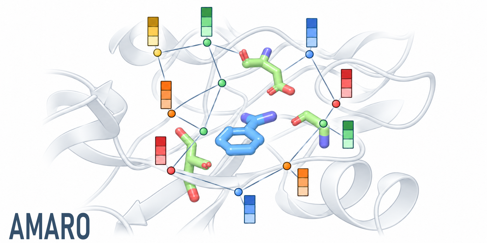

# AMARO v2.0

AMARO is a coarse-grained neural network potential that retains heavy atoms
and treats solvent implicitly. AMARO v2 extends the framework to proteins,
drug-like molecules, and their complexes using hydrogen-aware bead types and
total-charge conditioning.

## Repository organization

| Directory | Contents |
| --- | --- |
| [torchmd-net/](torchmd-net/) | AMARO model implementation; TorchMD-Net Git submodule |
| [system-prepare/](system-prepare/README.md) | System preparation, NOH bead mapping, and prepared examples |
| [openmm-pythonforce/](openmm-pythonforce/README.md) | OpenMM PythonForce runner, configuration, and simulation instructions |

The three AMARO v2 checkpoints will be released together on
[Hugging Face: compsciencelab/AMARO2](https://huggingface.co/compsciencelab/AMARO2).
The model and results are described in the
[AMARO v2 preprint](https://arxiv.org/pdf/2610.37606v1).

## Clone

Clone with the TorchMD-Net submodule:

```bash
git clone --recurse-submodules \
  https://github.com/compsciencelab/amaro.git
cd amaro
```

For an existing checkout, run `git submodule update --init --recursive`.

## Install

The following setup targets **Linux, Python 3.13, PyTorch 2.8.0, and CUDA 12.6**.
It requires an NVIDIA GPU with a compatible driver. Run all commands from the
repository root. Conda can be used in place of Mamba.

```bash
mamba create -n amaro_v2 python=3.13
mamba activate amaro_v2

python -m pip install -c constraints-cuda126.txt 'torch==2.8.0' \
  --index-url https://download.pytorch.org/whl/cu126

python -m pip install -c constraints-cuda126.txt 'openmm[cuda12]'

python -m pip install -c constraints-cuda126.txt \
  -e ./torchmd-net moleculekit pyyaml huggingface_hub
```

The [constraints file](constraints-cuda126.txt) keeps PyTorch and the CUDA runtime
packages on the selected versions. Install the checked-out `torchmd-net` submodule
to use the AMARO model implementation. The CUDA wheel and OpenMM installation
options follow the [PyTorch](https://pytorch.org/get-started/previous-versions/#v280)
and [OpenMM](https://docs.openmm.org/latest/userguide/application/01_getting_started.html)
installation guides.

Verify the environment:

```bash
python -m pip check
python -m openmm.testInstallation
python -c "import openmm; assert hasattr(openmm, 'PythonForce')"
python -c "import torch; print(torch.__version__, torch.version.cuda, torch.cuda.is_available())"
```

The PyTorch check should report `2.8.0+cu126`, `12.6`, and `True`.
Preparing new systems may require additional dependencies described in the
[preparation guide](system-prepare/README.md).

## Checkpoints and simulations

The three v2 checkpoints correspond to sequential training stages:

| Checkpoint | Training stage |
| --- | --- |
| `amaro_v2_sm.ckpt` | Small molecules |
| `amaro_v2_p.ckpt` | Continued training on mdCATH proteins |
| `amaro_v2.ckpt` | Continued training on protein–ligand complexes; final model |

After publishing the `v2.0` release on Hugging Face, download the final model:

```bash
hf download compsciencelab/AMARO2 amaro_v2.ckpt --revision v2.0 --local-dir ckpts
```

To download all three training stages:

```bash
hf download compsciencelab/AMARO2 \
  amaro_v2_sm.ckpt amaro_v2_p.ckpt amaro_v2.ckpt \
  --revision v2.0 --local-dir ckpts
```

Follow the [OpenMM PythonForce guide](openmm-pythonforce/README.md) to run a
simulation with the [prepared example](system-prepare/examples/1BTY_HoloSet/README.md)
or your own system. AMARO inputs use NOH species IDs rather than ordinary
atomic numbers.

## Citation

Please cite both works when using AMARO v2.

**AMARO v1.0** — [Published article](https://doi.org/10.1021/acs.jctc.4c01239).

```bibtex
@article{mirarchi2024amaro,
  title = {AMARO: All Heavy-Atom Transferable Neural Network Potentials of Protein Thermodynamics},
  author = {Mirarchi, Antonio and Pel{\'a}ez, Ra{\'u}l P. and Simeon, Guillem and De Fabritiis, Gianni},
  journal = {Journal of Chemical Theory and Computation},
  volume = {20},
  number = {22},
  pages = {9871--9878},
  year = {2024},
  doi = {10.1021/acs.jctc.4c01239}
}
```

**AMARO v2.0** — [arXiv:2610.37606v1](https://arxiv.org/pdf/2610.37606v1).

```bibtex
@unpublished{mirarchi2026amarov2,
  title = {A unified coarse-grained neural network potential for the dynamics of biomolecular complexes},
  author = {Mirarchi, Antonio and Farr, Stephen E. and Perez, Adria and De Fabritiis, Gianni},
  year = {2026},
  eprint = {2610.37606},
  archivePrefix = {arXiv},
  primaryClass = {q-bio.BM},
  url = {https://arxiv.org/pdf/2610.37606v1},
  note = {Version 1}
}
```
